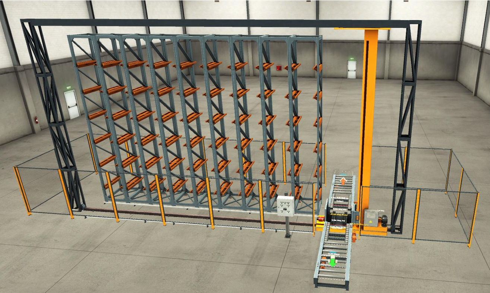
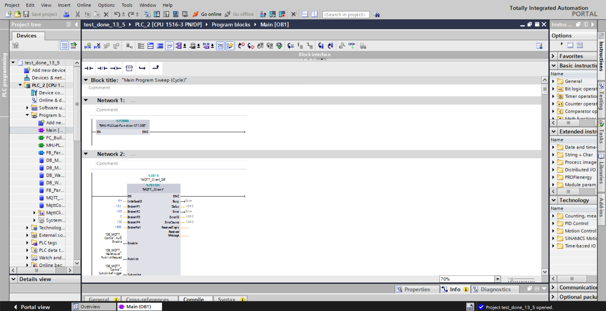
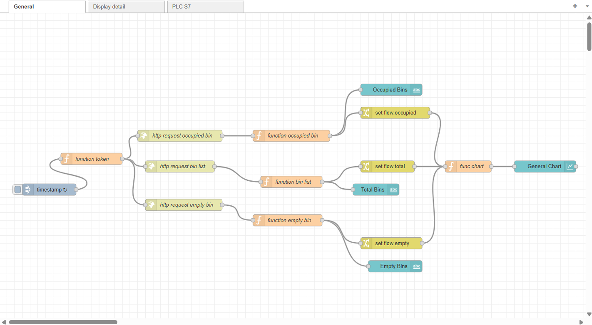
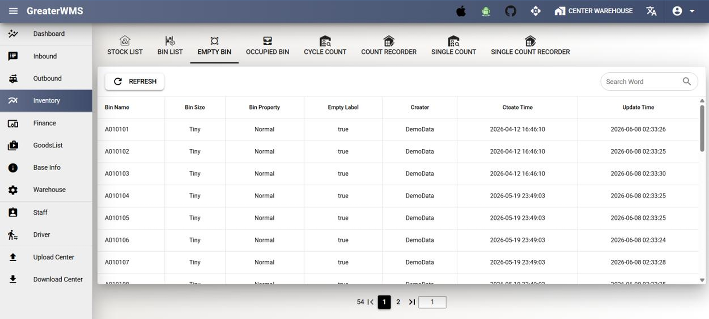
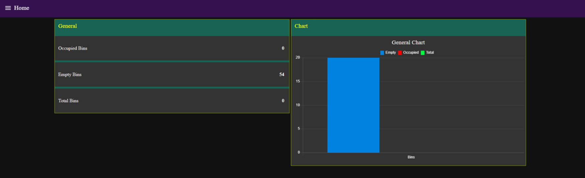
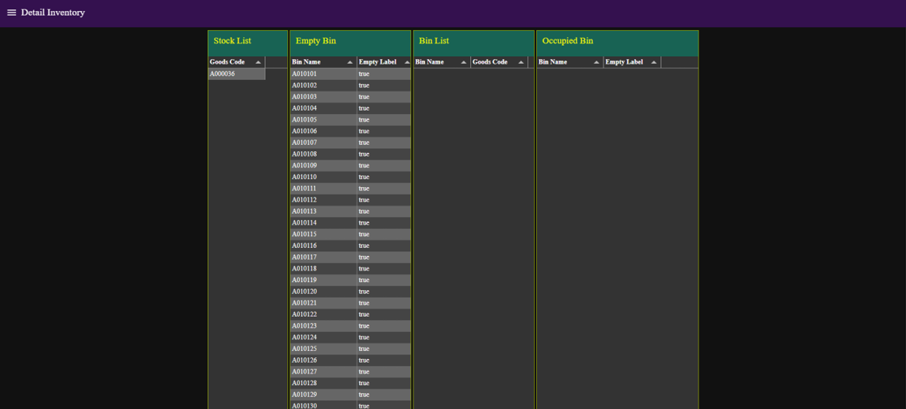
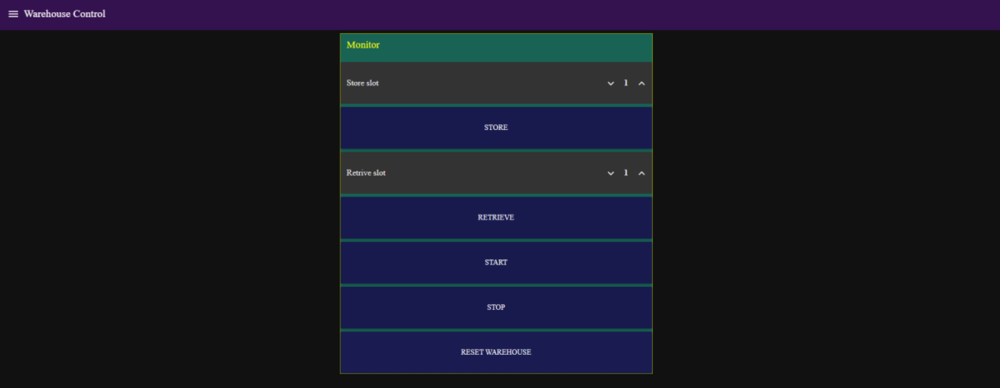

# Automated Warehouse Control and Monitoring System

**Academic Project | Ho Chi Minh City University of Technology (HCMUT), VNU-HCM | 2026**

An integrated **automated storage and retrieval system (AS/RS) prototype** combining a simulated warehouse, PLC-based control, MQTT messaging, a Node-RED operator dashboard, and the open-source GreaterWMS platform. This is an individual academic engineering project.

> **Scope:** This is a simulation-based prototype, not a deployed industrial warehouse. The project demonstrates control, monitoring, and selected inventory synchronization workflows.

## 1. Project Overview

The system models a warehouse with **54 storage locations**. Operators can select a bin and issue **STORE** or **RETRIEVE** commands through a Node-RED dashboard. PLC logic coordinates the simulated material-handling equipment in Factory I/O. MQTT carries commands and bin-status messages, while Node-RED uses GreaterWMS REST APIs to display and update selected inventory information.

### Main capabilities

- Simulated storage and retrieval operations for a 54-bin warehouse.
- PLC control logic developed in Siemens TIA Portal.
- Node-RED controls for **START**, **STOP**, **STORE**, **RETRIEVE**, and **RESET WAREHOUSE**.
- MQTT-based command transmission and bin-status monitoring.
- Dashboard views for total, empty, and occupied bins, including a summary chart.
- GreaterWMS REST API integration for stock and bin information.
- Inventory tables showing stock codes, bin assignments, and empty/occupied status.

## 2. System Architecture


<p align="center">
  
</p>

<p align="center">
  <em>Figure 1. System architecture of the automated warehouse prototype.</em>
</p>
  

The diagram illustrates the system's principal data path: **Factory I/O** simulates warehouse equipment and communicates with the **Siemens S7-1500 PLC**; the PLC publishes data through an **MQTT broker**, which **Node-RED** subscribes to and processes. From Node-RED, **REST APIs** connect to **GreaterWMS** for inventory data, while the **web UI** presents dashboard monitoring. The diagram emphasizes the monitoring/data flow; operator commands and return paths are also implemented in the Node-RED flows and should not be inferred solely from the one-way arrows shown.

The repository does not include a hosted or ready-to-run GreaterWMS instance.

## 3. Technology Stack

| Layer | Technology | Role |
|---|---|---|
| Simulation | Factory I/O | Warehouse scene and material-handling simulation |
| Control | Siemens TIA Portal V17 / S7-1500 project | PLC logic and sequencing |
| Messaging | MQTT | Control commands and bin-status messages |
| Integration and HMI | Node-RED | Dashboard, message processing, API integration |
| Warehouse management | GreaterWMS (open source) | Stock and bin information |
| Interfaces | HTTP REST / JSON | GreaterWMS data exchange |

## 4. Node-RED Implementation

The exported Node-RED project contains three main flow tabs:

| Flow tab | Function |
|---|---|
| `General` | Fetches warehouse-bin information and displays total, empty, and occupied counts with a chart |
| `Display detail` | Retrieves paginated stock/bin records, combines results, removes duplicates where applicable, and renders tables |
| `PLC S7` | Provides operator controls, sends MQTT commands, receives bin status, and builds GreaterWMS update requests |

**Examples of MQTT topics in the flow:**

```text
factoryio/warehouse/cmd/store
factoryio/warehouse/cmd/retrieve
factoryio/warehouse/cmd/system
factoryio/warehouse/bin_status
```

**Examples of GreaterWMS endpoints used:**

```text
GET /stock/list/
GET /stock/bin/
GET /binset/?empty_label=true
GET /binset/?empty_label=false
```

The control flow also contains prototype-specific bin-update and stock/bin-update requests. These depend on the local GreaterWMS configuration and are not presented as a general-purpose WMS connector.

## 5. My Implementation

This is an **individual project**. My implementation and integration work includes:

- Configuring and integrating the Factory I/O warehouse simulation and Siemens PLC project.
- Developing the Node-RED dashboard for warehouse status and inventory information.
- Implementing Node-RED logic to retrieve and process GreaterWMS REST API responses.
- Handling paginated API responses and preparing records for dashboard tables.
- Implementing dashboard commands and MQTT message handling for warehouse operations.
- Integrating received bin-status messages with prototype GreaterWMS update requests.
- Testing the integrated simulated warehouse workflow.

GreaterWMS is an existing open-source platform used in the project; I do **not** claim to have developed the GreaterWMS software itself.


## 6. System Demonstration

This section presents the main components of the automated warehouse prototype, including the Factory I/O simulation, PLC communication, Node-RED integration flows, GreaterWMS inventory data, and operator dashboards.

### 6.1. Automated Warehouse Simulation — Factory I/O

The automated warehouse was modeled in Factory I/O with 54 storage locations, a conveyor system, and an automated storage and retrieval mechanism.

The simulation provides a virtual environment for testing warehouse operations and PLC-based control logic without requiring physical industrial equipment.

<p align="center">
  
</p>

<p align="center">
  <em>Figure 2. Automated warehouse simulation in Factory I/O.</em>
</p>

### 6.2. PLC Programming and MQTT Communication

The PLC control program was developed in Siemens TIA Portal using an S7-1500 controller.

MQTT communication was incorporated into the PLC program to support data exchange with the Node-RED integration layer through an MQTT broker.

The screenshot below shows the MQTT client function block configured within the PLC main program.

<p align="center">
  
</p>

<p align="center">
  <em>Figure 3. MQTT client function block in Siemens TIA Portal.</em>
</p>

### 6.3. Node-RED Integration and Data Processing

Node-RED was used to develop the warehouse monitoring interface and integrate inventory information from GreaterWMS.

The example flow performs the following operations:

1. Initiates HTTP requests to GreaterWMS API endpoints.
2. Retrieves inventory and storage-location information.
3. Processes occupied-bin, empty-bin, and bin-list data using function nodes.
4. Updates dashboard indicators and the general chart.

<p align="center">
  
</p>

<p align="center">
  <em>Figure 4. Node-RED flow for inventory data retrieval, processing, and dashboard visualization.</em>
</p>

### 6.4. GreaterWMS Inventory Integration

GreaterWMS was used as an open-source warehouse management platform.

Inventory information was retrieved through REST API endpoints and displayed in the Node-RED monitoring interface.

The screenshot below shows the Empty Bin section of GreaterWMS, including storage-location identifiers and availability status.

<p align="center">
  
</p>

<p align="center">
  <em>Figure 5. Empty-bin inventory information displayed in GreaterWMS.</em>
</p>

### 6.5. Node-RED Monitoring and Control Dashboards

The Node-RED Dashboard was organized into three main interfaces: Home, Detail Inventory, and Warehouse Control.

#### A. Home — Warehouse Overview

The Home dashboard provides a summary of warehouse storage status, including:

- Occupied bins
- Empty bins
- Total bins
- A graphical overview of bin occupancy

<p align="center">
  
</p>

<p align="center">
  <em>Figure 6. Node-RED warehouse overview dashboard.</em>
</p>

#### B. Detail Inventory — Inventory Monitoring

The Detail Inventory dashboard displays warehouse information retrieved from GreaterWMS.

It includes four main tables:

- **Stock List:** Available product records.
- **Empty Bin:** Storage locations marked as available.
- **Bin List:** Storage-location and product associations.
- **Occupied Bin:** Storage locations marked as occupied.

<p align="center">
  
</p>

<p align="center">
  <em>Figure 7. Node-RED detailed inventory monitoring interface.</em>
</p>

#### C. Warehouse Control — Operator Interface

The Warehouse Control dashboard provides an interface for issuing warehouse commands.

Available controls include:

- **Store Slot:** Select the destination storage location.
- **STORE:** Issue a storage command.
- **Retrieve Slot:** Select the storage location for retrieval.
- **RETRIEVE:** Issue a retrieval command.
- **START:** Start the warehouse control process.
- **STOP:** Stop the warehouse control process.
- **RESET WAREHOUSE:** Reset the warehouse control state.

<p align="center">
  
</p>

<p align="center">
  <em>Figure 8. Node-RED operator interface for warehouse storage and retrieval commands.</em>
</p>

### 6.6. Storage and Retrieval Workflow

The prototype supports operator-initiated storage and retrieval operations through the Node-RED control interface.

**Storage workflow (STORE):**

1. The operator selects a destination storage slot.
2. The operator issues a STORE command through Node-RED.
3. The command is communicated to the PLC through MQTT.
4. The PLC executes the corresponding control sequence in Factory I/O.
5. Warehouse status information can be monitored through the integrated interfaces.

**Retrieval workflow (RETRIEVE):**

1. The operator selects a storage slot for retrieval.
2. The operator issues a RETRIEVE command through Node-RED.
3. The PLC receives the command and executes the retrieval sequence.
4. The simulated storage mechanism retrieves the item.
5. The resulting warehouse status is monitored through the dashboard.

The prototype was developed and tested in a simulation environment. The project demonstrates the integration of industrial PLC control, MQTT-based communication, Node-RED monitoring, and GreaterWMS inventory-data access.


## 7. Repository Structure

The repository is organized as follows:

```text
automated-warehouse-plc-iiot/
├── README.md
├── docs/
│   ├── system-architecture.png
│   ├── factory-io-warehouse.png
│   ├── tia-portal-mqtt.png
│   ├── node-red-api-flow.png
│   ├── greaterwms-inventory.png
│   ├── dashboard-overview.png
│   ├── dashboard-inventory.png
│   └── dashboard-control.png
├── factory-io/
│   └── New.factoryio
├── node-red/
│   └── warehouse-flows.json
└── plc/
    └── Automated_Warehouse_PLC_S7-1500.zap17
```

**Directory Description:**

- **`docs/`**: System architecture diagram and screenshots of the Factory I/O simulation, TIA Portal, Node-RED flows, GreaterWMS integration, and monitoring dashboards.
- **`factory-io/`**: Factory I/O simulation scene of the automated warehouse.
- **`node-red/`**: Exported Node-RED flows for monitoring, warehouse control, MQTT communication, and GreaterWMS REST API integration.
- **`plc/`**: Archived Siemens TIA Portal V17 PLC project containing the warehouse control program.

## 8. How to Inspect the Project

- **PLC:** Open the archive using the compatible Siemens TIA Portal version (V17). PLC hardware configuration and dependencies may be required to run the project.
- **Factory I/O:** Open the scene using a compatible Factory I/O installation.
- **Node-RED:** Import the JSON file via **Menu → Import**. Install the additional Node-RED nodes used by the project as required, then configure the MQTT broker, PLC connection, and GreaterWMS API settings for your own environment.
- **GreaterWMS:** Install and configure GreaterWMS separately, following the documentation and license of the original open-source project. Its source code is **not redistributed here**.

**Security:** The shared Node-RED export is intended to be sanitized. Replace placeholder endpoints and credentials locally. Do not commit active API tokens, passwords, private keys, or private database dumps. Review the repository contents before publishing it.

## 9. Limitations and Future Work

- The warehouse is simulated; no physical deployment or industrial reliability validation is claimed.
- Some bin-to-database-ID mappings are configured for the demonstration dataset.
- Some inventory-update logic uses a fixed demonstration goods code rather than a general product-tracking workflow.
- API pagination and synchronization logic reflect the test environment and may require adaptation for larger datasets or other GreaterWMS versions.
- Potential improvements include configurable bin mapping, richer product and quantity tracking, better error handling, and more extensive end-to-end testing.

## 10. Acknowledgments

Developed as an individual academic project at **Ho Chi Minh City University of Technology (HCMUT), VNU-HCM**. The project uses third-party engineering tools and the open-source GreaterWMS platform; their respective rights and licenses remain with their owners.
